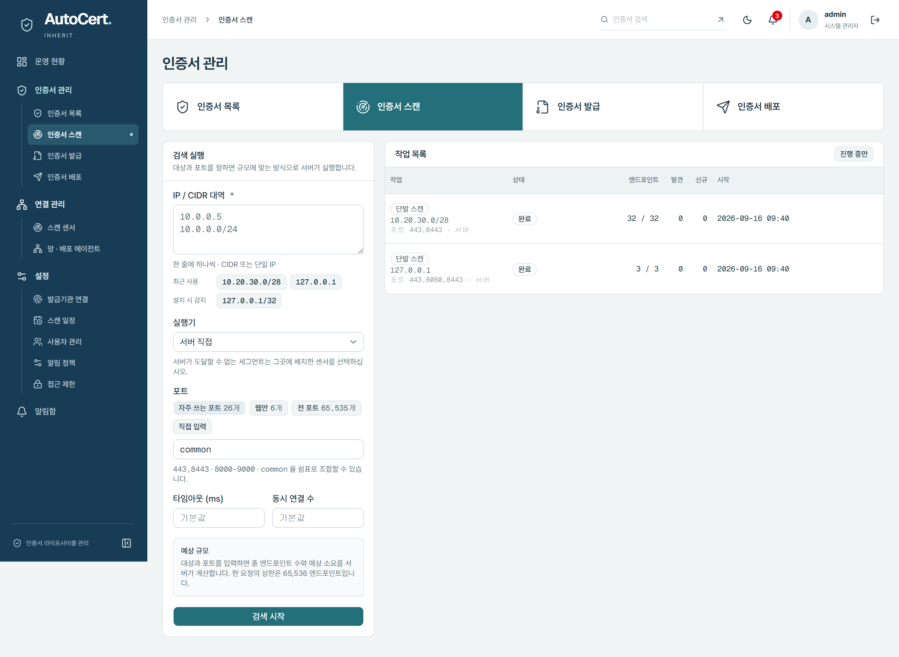
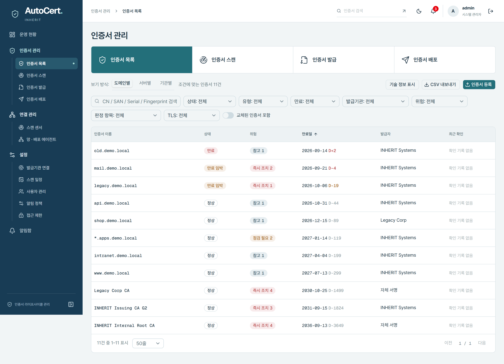
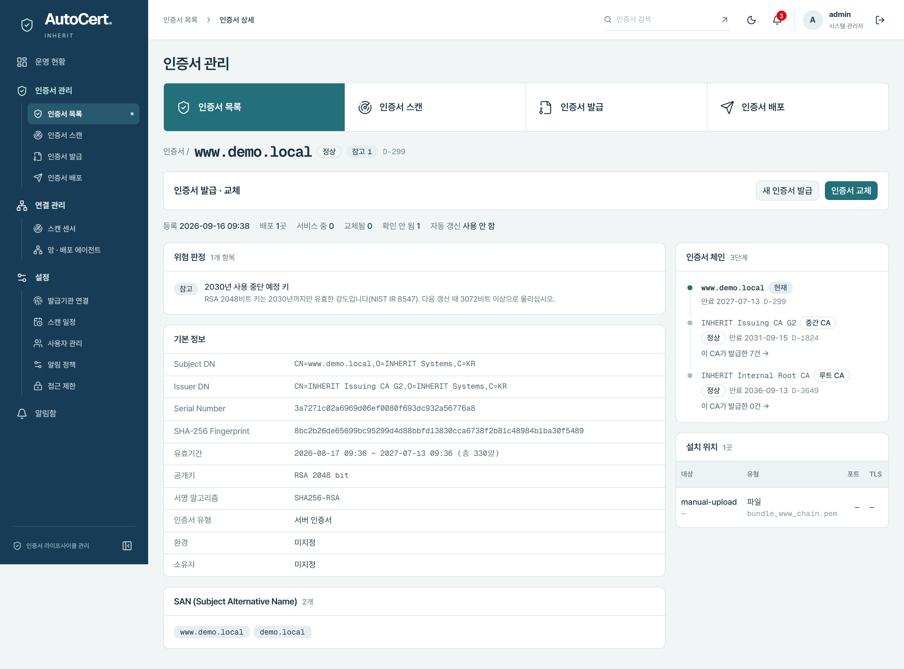
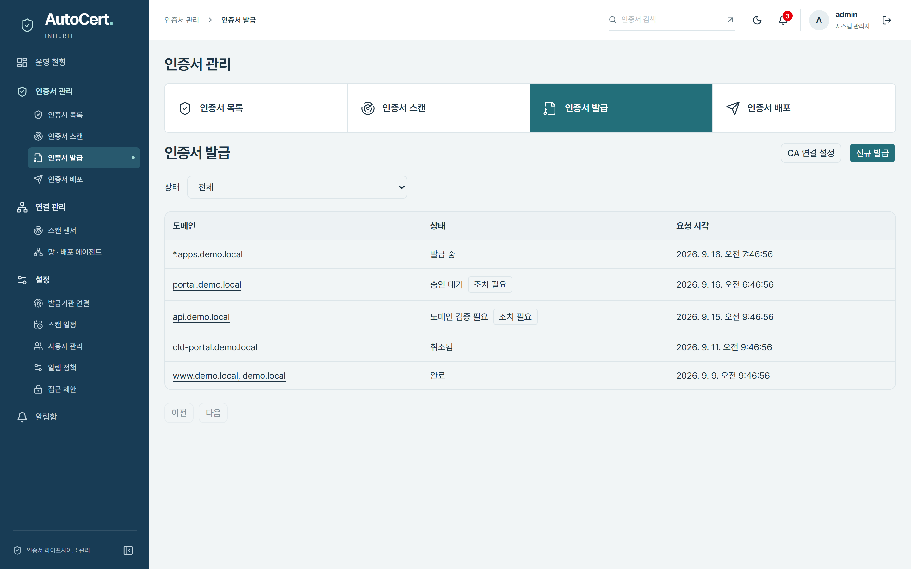
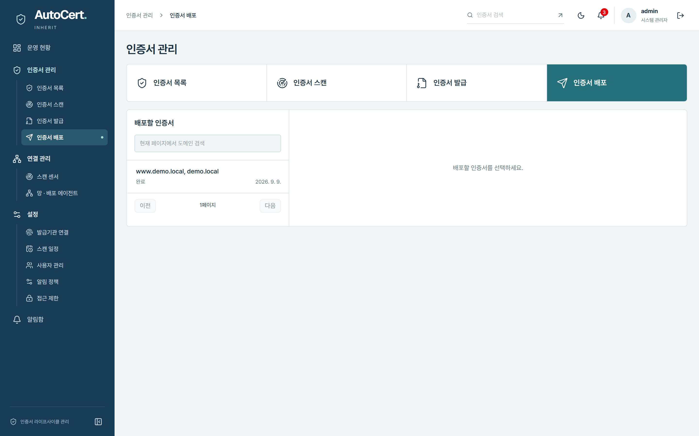
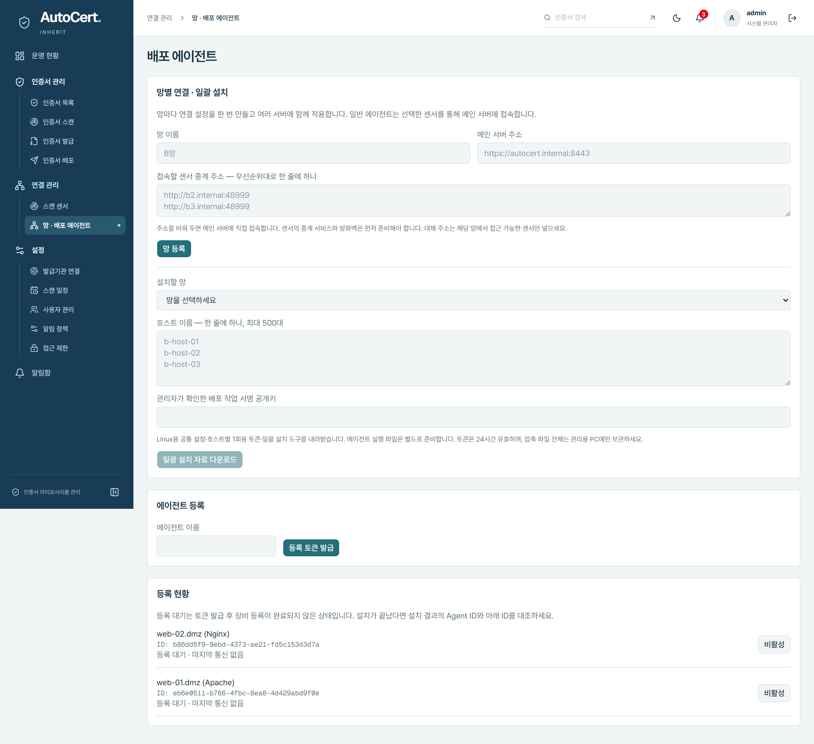
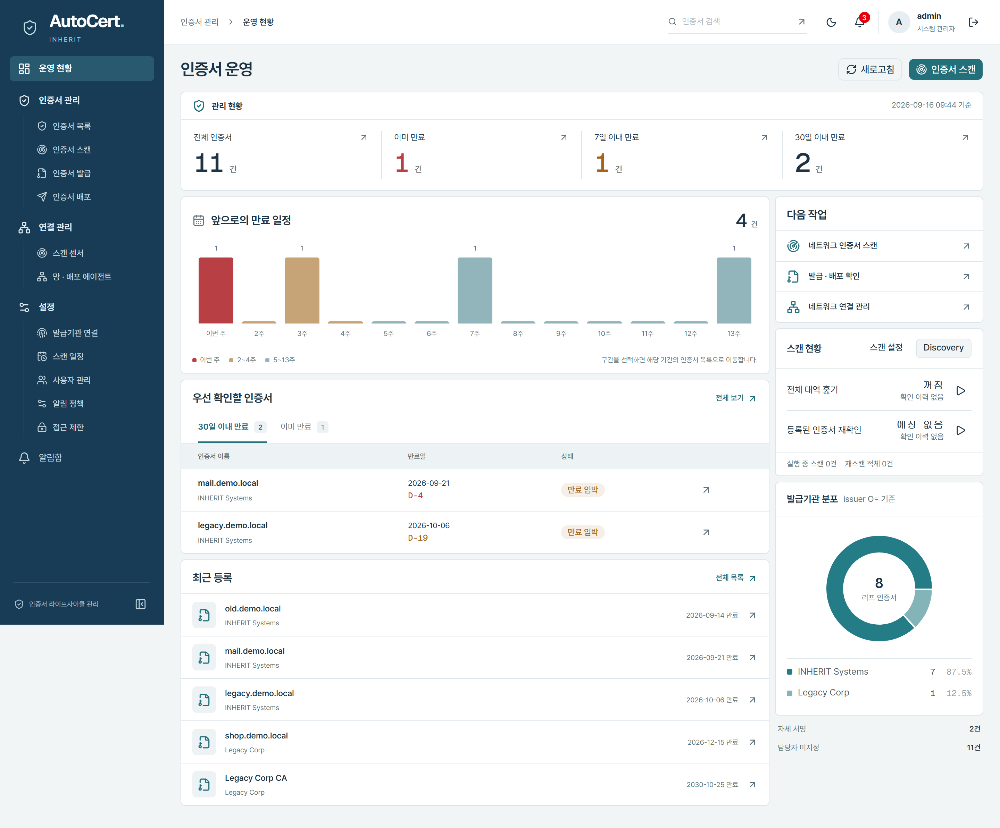
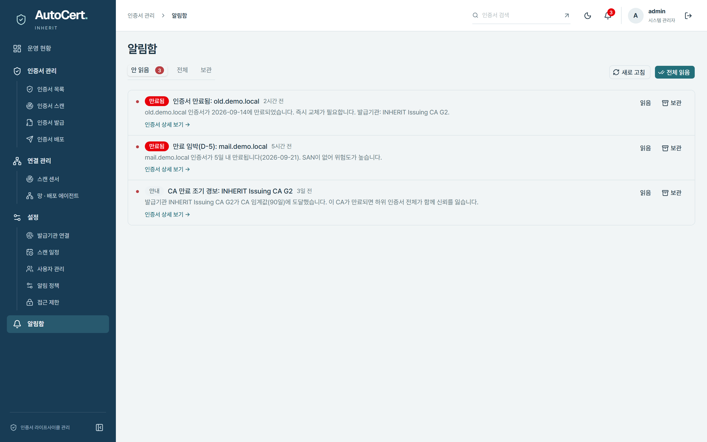
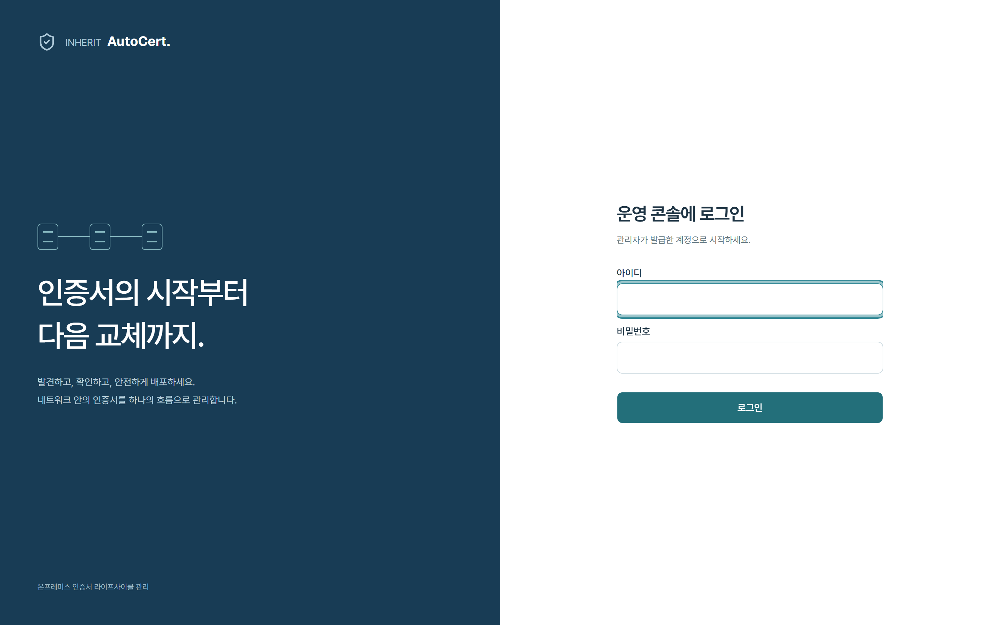

# INHERIT_AutoCert 제품소개

## 한 줄 정의

INHERIT_AutoCert는 폐쇄망·레거시 환경에서 쓰는 온프레미스 인증서 라이프사이클 관리(CLM) 플랫폼입니다. 인터넷에 연결되지 않은 내부망에서도 TLS 인증서의 발견·위험 판정·발급·배포·갱신 준비·폐기까지 한 곳에서 관리합니다.

## 해결하는 문제

많은 조직이 서버·장비마다 흩어진 인증서를 엑셀과 담당자 기억에 의존해 관리합니다. 그 결과 다음 문제가 반복됩니다.

- 어디에 어떤 인증서가 있는지 전체를 파악하지 못해, 만료 사고가 서비스 중단으로 이어집니다.
- 약한 키·레거시 TLS·불완전한 체인 같은 위험을 자산 단위로 점검하기 어렵습니다.
- 인터넷 연결이 막힌 폐쇄망에서는 클라우드형 인증서 관리 도구를 쓸 수 없습니다.
- 발급·교체 작업이 수작업이라 실수가 잦고, 무엇을 언제 누가 바꿨는지 추적하기 어렵습니다.

INHERIT_AutoCert는 이 문제를 폐쇄망에 설치하는 온프레미스 제품으로 풉니다. 외부 연결 없이 내부망 자산을 스캔하고, 위험을 자동으로 판정하며, 발급과 교체를 감사 가능한 워크플로우로 처리합니다.

---

## 핵심 가치

- **폐쇄망 우선 설계**: 인터넷 없이도 동작합니다. 오프라인 설치 아카이브로 배포하고, 다단 중계 구조로 분리된 내부 구간의 자산까지 스캔합니다.
- **자산 전체의 가시성**: 네트워크 스캔·파일 가져오기로 인증서를 모아 목록·서버·발급기관 축으로 한눈에 봅니다. 만료 임박과 위험을 대시보드에서 바로 확인합니다.
- **위험의 자동 판정**: 15종 규칙으로 약한 키·레거시 TLS·체인 이상 등을 심각도 4단계로 분류하고, CA가 만료될 때 영향받는 자산을 미리 계산합니다.
- **감사 가능한 자동화**: 발급·배포·교체를 승인 게이트와 감사 로그가 있는 워크플로우로 실행합니다. 핵심 작업은 명시적 상태 머신으로 처리해 재시도·롤백·추적이 가능합니다.
- **레거시 환경 대응**: 오래된 웹서버·장비가 섞인 환경을 전제로 만들었습니다. 에이전트가 실장비에서 인증서를 교체하고 서비스를 다시 적용합니다.

---

## 현재 제공 기능

### 1. 인증서 발견과 인벤토리

내부망 IP·포트 대역을 스캔해 TLS 엔드포인트의 인증서를 수집합니다. 대규모 자산은 전 포트 백그라운드 스윕으로 나눠 훑고, 정기 스캔을 예약해 자동으로 재점검합니다. 이미 가진 PEM/DER 인증서 파일은 업로드해 인벤토리에 등록할 수 있습니다(개인키가 섞인 파일은 자동 거부). 수집한 인증서는 발급기관·위험·TLS 버전·만료 조건으로 검색·필터·정렬하고, 감사 기록과 함께 CSV로 내보냅니다.

### 2. 위험 판정과 자산 영향 분석

조회 시점에 15종 규칙으로 인증서 위험을 판정합니다. 약한 키·약한 서명, SAN 없음, 와일드카드, 만료된 CA, 체인 이상, 레거시 TLS, 불완전한 체인 등을 심각도 4단계로 분류합니다. 서버(엔드포인트) 축으로 보면 호스트별로 지금 쓰는 인증서와 위험을 정렬해 확인할 수 있습니다. CA 영향도 분석은 "이 CA가 만료되면 어떤 리프·도메인·서버가 영향받는가"를 재귀적으로 집계하고, 발급기관 분포와 다계층 CA 트리를 보여줍니다.

### 3. 인증서 발급

외부 CA를 연결하고 연결 테스트·상품 조회를 거쳐 발급 주문을 만듭니다. 발급 워크플로우에는 승인 게이트가 있어, 승인 권한을 가진 역할만 발급을 확정할 수 있습니다. 주문은 생성·승인·취소·재시도를 지원합니다. 발급 과정에서 기간·DNS·키·체인이 어긋나면 등록을 막는 대신 비교 결과를 경고로 보존해, 담당자가 판단할 근거를 남깁니다.

### 4. 인증서 배포와 교체

배포 대상을 관리하고 배포 주문을 실행합니다. 에이전트가 실장비에서 인증서를 교체하며, 웹서버 서명·mTLS·서비스 재적용까지 여러 단계를 거치고 장애 복구 경로를 포함합니다. 배포가 끝나면 해당 엔드포인트를 자동으로 다시 스캔해 교체가 실제로 반영됐는지 확정합니다. 배포 작업은 독립 서명과 재전송 방지 장치로 보호합니다.

### 5. 센서와 에이전트 운영

분산된 내부 구간에는 센서를, 실장비에는 에이전트를 둡니다. 센서는 1회용 토큰과 mTLS 게이트웨이로 등록하고, 에이전트는 토큰 발급·등록·비활성화와 신원 봉인을 지원합니다. 센서는 리스 기반 상태 머신으로 관측 작업을 안전하게 나눠 받습니다.

### 6. 폐쇄망 중계와 일괄 설치

인터넷이 없는 분리 구간을 위해 센서 중계 구조를 제공합니다. 센서가 상위로 다단 연결하고, 경로 후보에 장애가 나면 다른 후보로 전환합니다. 망별 프로필을 만들어 관리하고, 호스트별 개별 토큰을 담은 일괄 설치 자료를 ZIP으로 내려받아 여러 장비에 한 번에 배포합니다.

### 7. 운영 현황 대시보드

운영 현황 대시보드에서 서버 인증서와 관리 인벤토리를 토글로 전환하며 봅니다. 만료 임박(7·30·60·90일) 집계, 발급기관 분포, 위험 위젯을 한 화면에 모으고, 이미 교체된 인증서는 현황에서 제외합니다. 발견 작업(스캔·스윕·스케줄 실행)은 통합 목록에서 확인합니다.

### 8. 만료 알림

만료 알림 정책을 만들어 임계값(90·60·30·7일, CA 전용 임계값 포함)을 설정하고 테스트 발송으로 확인합니다. 이메일·웹훅·syslog·인앱 인박스 네 가지 채널을 지원하며, 인앱 알림은 목록·안 읽음 수·읽음/보관 처리를 제공합니다.

### 9. 보안·감사·접근 제어

모든 변경 API가 감사 이벤트를 남기고, 해시 체인으로 감사 기록의 무결성을 검증합니다. 요청마다 역할 기반 권한(RBAC, 6개 역할)을 확인하고, 관리 콘솔은 IP 허용목록으로 접근을 제한합니다(락아웃 방지 포함). 세션 인증과 초기 관리자 설정, 사용자 관리(생성·수정·활성/비활성·비밀번호 재설정)를 제공합니다. 개인키는 평문으로 저장하지 않고 봉인 암호화하며, 로그에 인증서·개인키를 남기지 않습니다.

### 10. 배포와 운영 형태

Docker Compose 기반 온프레미스 배포를 지원하고, 폐쇄망을 위한 오프라인 설치 아카이브(메인·센서·에이전트, Linux)를 제공합니다. API는 OpenAPI 3 스펙으로 문서화합니다.

---

## 향후 로드맵

아래는 계획된 방향이며, 세부 시점과 지원 범위는 도입 환경에 맞춰 협의합니다.

### 소유권과 워크플로 강화

- 인증서·서버 단위의 서비스 소유자 지정으로 조직 변경 시 소유권 유실을 방지
- 만료 알림의 확인·일시 보류와 미처리 알림의 상위 담당자 에스컬레이션
- 위험을 정량화하는 정책 위반 점수와 기간별 현황 리포트

### 커넥터 확대

- CMDB·ITSM·Kubernetes·로드밸런서/WAF 인벤토리 가져오기로 스캔 커버리지 확대
- WebtoB 설정 파일 read-only 파서로 설정과 스캔 결과 대조
- CA 연동 확대(예: EJBCA·step-ca·클라우드 Private CA 계열), 인증 연동(LDAP·Active Directory·OIDC·SAML), 알림 채널 확대(Slack·Microsoft Teams·SMS·SIEM)

### 발급·갱신 오케스트레이션

- 내부 ACME 호환 게이트웨이로 표준 클라이언트 요청을 정책·승인·감사 경로에 태워 상위 CA에 주문
- CA 어댑터 추상화로 다양한 CA를 통일된 발급 경로에 연결
- 정책 기반 갱신 스케줄러와 승인 워크플로

### 배포 자동화 확대

- 환경별 배포 어댑터 확대(Nginx·Apache·IIS·파일·Kubernetes Secret 등)
- 여러 CA 동시 운용(Multi-CA)
- Helm Chart·Kubernetes 표준 설치 경로

### 관측성과 운영

- Prometheus 메트릭 노출과 OpenTelemetry 분산 트레이스
- 폐쇄망용 오프라인 라이선스
- AI 보조 기능(자연어 검색·위험 설명·실패 로그 요약·소유자 추천) — AI는 설명·요약·추천 보조로만 쓰고, 인증서 작업 실행 경로에는 두지 않습니다.

---

## 도입과 배포 형태

- **온프레미스 설치**: 고객 내부망에 Docker Compose로 설치합니다. 데이터와 키는 고객 환경 안에만 머뭅니다.
- **오프라인 아카이브**: 인터넷이 차단된 폐쇄망을 위해 메인·센서·에이전트를 오프라인 설치 아카이브로 제공합니다. 외부 저장소에 접근하지 않고 설치·업데이트합니다.
- **분산 구조**: 메인 콘솔에 센서와 에이전트를 연결하고, 분리된 내부 구간은 다단 중계로 연결합니다.
- **표준 인터페이스**: REST API를 OpenAPI 3 스펙으로 제공해 기존 운영 도구와 연동할 수 있습니다.

도입 규모와 망 구성, 연동 대상에 맞춘 구성은 별도로 협의합니다.
